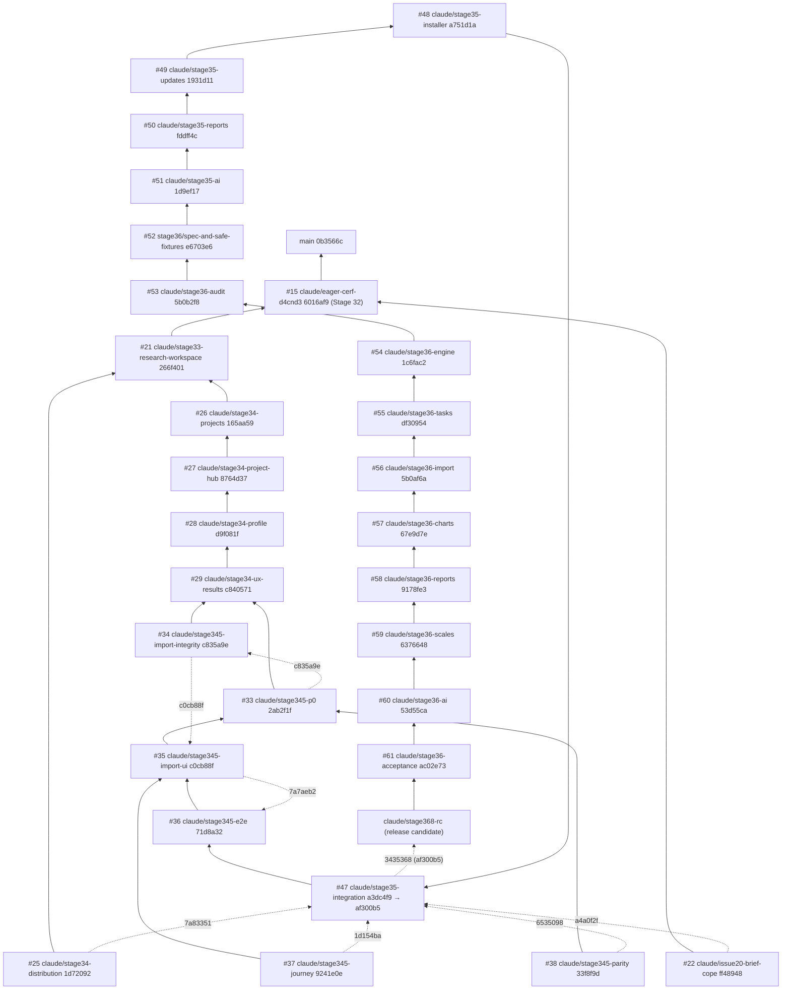

# Stage 36.8 — branch integration audit

This audit establishes, from Git ancestry and the code itself, which work
the release candidate contains. PR titles and green checks were not used as
evidence. Every statement below can be re-run with the commands in the last
section.

**Audited head:** `ac02e73` (PR #61, `claude/stage36-acceptance`).
**Release-candidate branch:** `claude/stage368-rc`, which starts at `ac02e73`.

## Result in one paragraph

Every head of the audited PRs is an ancestor of the release candidate:
- #15, #21, #22, #25–#29, #33–#38, #47–#51 and #52–#61;
- `main` (`0b3566c`).

Only one commit was missing from `ac02e73`. It was `af300b5` on `claude/stage35-integration` (PR #47), which adds `docs/STAGE35_INTEGRATION.md`. It was committed after #48 had branched from `a3dc4f9`. The commit is merged into the release candidate as `3435368`, with a merge commit so that attribution is kept.

PRs #1–#13 were squash-merged into `main`. For each one, the tree of the branch head equals a commit on `main`, so their content is in the release candidate through `main`.

The tests of the four independent workstreams (#22, #25, #37, #38) and of the Stage 35 installer and updater pass on the release candidate.

## Dependency graph

Arrows point from a branch to the branch it was started from. A dotted
arrow marks a side branch that was merged into the main line, labelled with
its merge commit.



## Every audited PR

**Columns:**
- **Head** — the branch head now.
- **Base at creation** — the base SHA that GitHub records for the PR.
- **In RC** — whether the head is an ancestor of the release candidate.
- **Unique** — commits not in the release candidate.

| PR | Branch | Head | Base at creation | In RC | Unique | How it joined the main line |
|---|---|---|---|---|---:|---|
| #15 | `claude/eager-cerf-d4cnd3` | `6016af9` | `0b3566c` (main) | yes | 0 | via the merge in #22 (`ff48948`) |
| #21 | `claude/stage33-research-workspace` | `266f401` | `6016af9` | yes | 0 | first-parent chain |
| #22 | `claude/issue20-brief-cope` | `ff48948` | `6016af9` | yes | 0 | `a4a0f2f` into the Stage 35 integration branch |
| #25 | `claude/stage34-distribution` | `1d72092` | `266f401` | yes | 0 | `7a83351` into the Stage 35 integration branch |
| #26 | `claude/stage34-projects` | `165aa59` | `266f401` | yes | 0 | first-parent chain |
| #27 | `claude/stage34-project-hub` | `8764d37` | `165aa59` | yes | 0 | merged into #28 (`d9f081f`) |
| #28 | `claude/stage34-profile` | `d9f081f` | `8764d37` | yes | 0 | first-parent chain |
| #29 | `claude/stage34-ux-results` | `c840571` | `d9f081f` | yes | 0 | first-parent chain |
| #33 | `claude/stage345-p0` | `2ab2f1f` | `c840571` | yes | 0 | `c835a9e` (into #34) |
| #34 | `claude/stage345-import-integrity` | `c835a9e` | `c840571` | yes | 0 | `c0cb88f` (into #35) |
| #35 | `claude/stage345-import-ui` | `c0cb88f` | `2ab2f1f` | yes | 0 | `7a7aeb2` (into #36) |
| #36 | `claude/stage345-e2e` | `71d8a32` | `c0cb88f` | yes | 0 | first-parent chain |
| #37 | `claude/stage345-journey` | `9241e0e` | `c0cb88f` | yes | 0 | `1d154ba` into the Stage 35 integration branch |
| #38 | `claude/stage345-parity` | `33f8f9d` | `2ab2f1f` | yes | 0 | `6535098` into the Stage 35 integration branch |
| #47 | `claude/stage35-integration` | `af300b5` | `71d8a32` | **now yes** | **1 → 0** | `a3dc4f9` is on the chain; `af300b5` (one docs commit) was missing and is merged into the RC as `3435368` |
| #48 | `claude/stage35-installer` | `a751d1a` | `a3dc4f9` | yes | 0 | `3f5fd16` |
| #49 | `claude/stage35-updates` | `1931d11` | `a751d1a` | yes | 0 | `fddff4c` |
| #50 | `claude/stage35-reports` | `fddff4c` | `1931d11` | yes | 0 | `049caba` |
| #51 | `claude/stage35-ai` | `1d9ef17` | `fddff4c` | yes | 0 | first-parent chain |
| #52 | `stage36/spec-and-safe-fixtures` | `e6703e6` | `1d9ef17` | yes | 0 | first-parent chain |
| #53 | `claude/stage36-audit` | `5b0b2f8` | `e6703e6` | yes | 0 | `1c6fac2` |
| #54 | `claude/stage36-engine` | `1c6fac2` | `5b0b2f8` | yes | 0 | `51618f3` |
| #55 | `claude/stage36-tasks` | `df30954` | `1c6fac2` | yes | 0 | `7b9f00b` |
| #56 | `claude/stage36-import` | `5b0af6a` | `df30954` | yes | 0 | `67e9d7e` |
| #57 | `claude/stage36-charts` | `67e9d7e` | `5b0af6a` | yes | 0 | `9178fe3` |
| #58 | `claude/stage36-reports` | `9178fe3` | `67e9d7e` | yes | 0 | `6376648` |
| #59 | `claude/stage36-scales` | `6376648` | `9178fe3` | yes | 0 | `53d55ca` |
| #60 | `claude/stage36-ai` | `53d55ca` | `6376648` | yes | 0 | `1fe4528` |
| #61 | `claude/stage36-acceptance` | `ac02e73` | `53d55ca` | yes | 0 | base of the release candidate |

### PRs #1–#13 and their branches (merged into `main` earlier)

These PRs were squash-merged, so their branch commits are not ancestors of
`main`. For each one, the tree of the branch head is identical to a commit
on `main`:

| Branch | Identical tree on `main` |
|---|---|
| `feature/questionnaire-pages-labels-dnd` | `7a0d3c6` |
| `feature/questionnaire-flexible-scales-sections` | `c36d6cf` |
| `feature/stage23-light-workspace-radio-scales` | `cb57d26` |
| `feature/stage24-languages-resilient-import` | `5e92748` |
| `feature/stage25-lv-ru-stat-help-apa7` | `b613e29` |
| `feature/stage26-interpretation-wizard-docx` | `8e4b20e` |
| `fix/file-picker-real-csv-excel-flow` | `b2d842b` |
| `fix/survey-preview-frozen-controls-grey-import-layout` | `b6b88e7` |
| `feature/stage28-survey-to-report-journey` | `e6e861c` |
| `feature/stage29-desktop-shell-document-survey-import` | `24f9d6d` |
| `feature/stage30-scientific-questionnaire-importer` | `f566053` |
| `feature/stage31-local-ocr-visual-edit` | `c1355eb` |
| `fix/deterministic-omega-bootstrap-ci` | `0b3566c` (the current `main`) |

## Feature inclusion matrix

How each workstream was checked:
- every file its PR added or changed was looked up in the release candidate;
- each file is marked "same" (identical to the PR head) or "evolved" (changed later);
- the PR's own tests were run on the release candidate.

Test runs: `python -m unittest discover -s tests -p <file>`.

| Workstream | Files (PR head → RC) | Its tests on the RC | Verdict |
|---|---|---|---|
| #22 Brief COPE-style import: letter-spacing repair, repeated four-choice blocks, 28 items, scoring evidence | 20 files, all present. Same: `letter_spacing.py`, `repeated_choices.py`, `ocr_layout.py`, `matrix_reconstruction.py`, `shared_scales.py`, `survey_ui.py`, `tests/test_brief_cope_import.py`. Evolved: `scientific_survey_import.py`, `scoring_evidence.py`, `visual_survey_review.py`, workflows | `test_brief_cope_import.py`: **28 OK** | included, no regression |
| #25 Measured Windows package audit, runtime-safe cleanup, single ZIP | 15 files, all present. Same: `analysis_selftest.py`, `tools/package_audit.py`, `tools/prune_packages.py`, `tools/flet_pack_compat.py`, `tools/startup_ab.py`, `docs/DISTRIBUTION_OPTIMIZATION.md`, `windows-packaging-experiments.yml`. Evolved: `pyproject.toml` (cleanup globs kept), `app.py`, `windows-package.yml` | `test_distribution_tools.py`: **15 OK**; the packaged analysis self-test runs in every `windows-package.yml` build | included |
| #37 Research journey, guided ANCOVA design, provenance, interpretation depth | 16 files, all present (`workspace_*` evolved by Stage 36) | `test_workspace_accents.py` 3, `test_workspace_guided_design.py` 5, `test_workspace_journey_strip.py` 4, `test_workspace_provenance.py` 6: **all OK** | included |
| #38 Engine ground truth against independent references | `tests/test_engine_ground_truth.py`, same | **33 OK** (the 33 numeric oracles of #62) | included, unchanged |
| Stage 35 installer (#48) and in-app updates (#49) | `packaging/`, `tools/build_installer.py`, `windows-installer.yml`, `windows-update-e2e.yml`, update modules | `test_updates.py` 41 OK (5 skipped: Windows-only, run in the Windows workflows); `test_app_identity.py` 12 OK; `test_legacy_data.py` 14 OK; installer and A → B update workflows green on `ac02e73` | included |

## Missing changes, overlaps and conflicts

- **Missing:** only `af300b5` (`docs/STAGE35_INTEGRATION.md`). It is now merged as `3435368`; it changes documentation only.
- **No other unique commits.** For every audited branch, `git rev-list --count RC..branch` is 0.
- **Overlapping functionality, by design, not duplication:**
  - **Two user interfaces.** The classic interface (`research_app.py`, `survey_ui.py`, `data_ui.py`) and the Stage 33+ workspace (`workspace_*.py`) both exist. The workspace is the default; the classic interface stays reachable for parity, and parity tests guard it.
  - **One Word stack.** `report_docx.py` (the research report) builds on `interpretation_docx.py` (the single-result Word report). They are layers of one stack, not competing implementations.
- **Conflicts resolved earlier**, all recorded in their merge commits:
  - Stage 35 integration: coroutine handler names per module (`ea29526`), found by integrating #25 with #33.
  - Stage 35 integration: downgrade safety (`a3dc4f9`).
  - Stage 36: the fixture generator (STIX variant beside the item-level CSV, `2866d0c`).
  - Stage 36: the driver's scan journey, whose change reached #61 twice (`7f5e5a9`).
- **Merging into `main` cannot conflict.** `main` (`0b3566c`) is an ancestor of the release candidate, so integrating the release candidate into `main` is a fast-forward of its history.

## Recommended merge order

Nothing is merged automatically.

**Recommended path: one reviewed merge of the release candidate.**
1. Review the release-candidate PR (base `claude/stage36-acceptance`). Review the stack below it in order: #15 → #21 → #26 → #27 → #28 → #29 → #33/#34 → #35 → #36 → #47 → #48 → … → #61.
2. When approved, change the release-candidate PR's base to `main` and merge it with **"Create a merge commit"**, not squash or rebase. Every commit, author line and test trailer is kept.
3. GitHub then marks #15, #21, #22, #25–#29, #33–#38 and #47–#61 as merged, because their head commits become reachable from `main`.

**Alternative: merge the stack PR by PR.**
- Change each PR's base to `main` in this first-parent order and merge each with a merge commit: #15, #21, #26, #28 (includes #27), #29, #36 (includes #33–#35), #47 (includes #22, #25, #37, #38), #48–#61, then the release candidate.
- Side-branch PRs become merged by inclusion.
- Each step is a fast-forward of content. Re-run the verification below after each step, or at least after #29, #36, #47, #51, #61 and the release candidate.

**What not to do:**
- **Squash merges.** They would drop the test traceability that the Stage 34.5–36 commits carry (each fix names the run that found it).
- **Rebasing the stack.** Every recorded SHA in the evidence documents would change.

## Verification after each integration step

Run on the merged commit itself; a result from another commit does not count:
1. `python -m unittest discover -s tests` — 1105+ tests, 7 skipped on Linux.
2. `windows-gui-e2e.yml` — every packaged journey.
3. `windows-installer.yml` — clean install, legacy migration, journeys on the installed program, B over A, uninstall keeps data, reinstall.
4. `windows-update-e2e.yml` — A → B, refused updates.
5. `windows-package.yml` — OCR self-test, packaged analysis self-test (identical report hashes), size budget.
6. `windows-native-dpi.yml`.
7. `python-tests.yml` — including the browser state checks and the Windows SQLite and research-journey jobs.

## Re-running this audit

```bash
git fetch origin '+refs/heads/*:refs/remotes/origin/*'
RC=origin/claude/stage368-rc
for b in $(git branch -r | sed 's/^ *origin\///'); do
  n=$(git rev-list --count $RC..origin/$b); [ "$n" != 0 ] && echo "$b: $n not in RC"
done
git merge-base --is-ancestor origin/main $RC && echo "main is an ancestor"
git log --ancestry-path --merges --format='%h %s' <pr-head>..$RC | tail -1   # how a side branch joined
```

The table above has been checked with these commands:
- no audited branch has commits outside the release candidate;
- the branches of PRs #1–#13 differ only by their squashed history, and their trees match the listed `main` commits.
