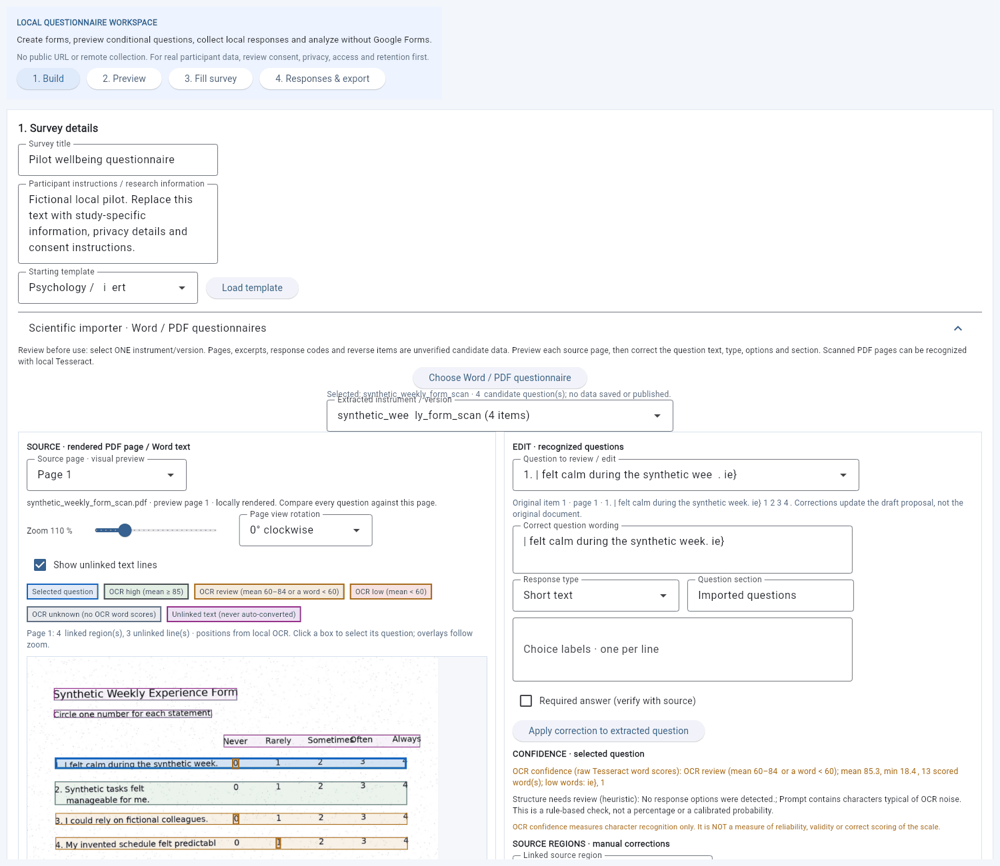
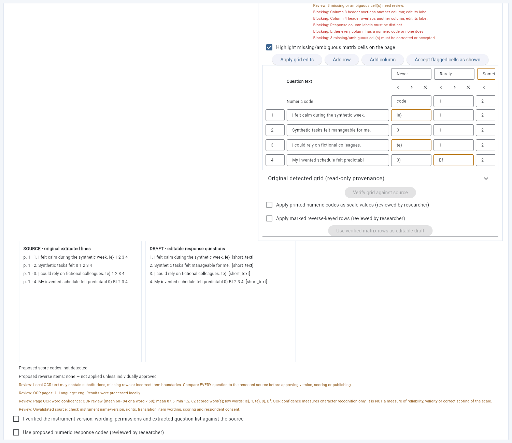

# Stage 31–32 — local OCR, spatial review and questionnaire matrices

## Stage 32 at a glance

* **No separate installation on Windows.** The Windows desktop package
  contains a pinned Tesseract 5 engine with English, Latvian and Russian
  language data. Check it under **Settings → Offline OCR engine…**.
* **Spatial review.** Every recognized word keeps its position on the page.
  Questions are highlighted directly on the rendered PDF page; click a box to
  open that question, zoom from 50–300 % without losing alignment.
* **Two separate kinds of certainty.** *OCR confidence* is Tesseract's raw
  character-recognition score per word; *structure status* is a rule-based
  check of how the question was reconstructed. Neither says anything about
  reliability, validity or correct scoring of a scale.
* **Matrix editor.** Row × column rating grids (Likert-type scales) from
  Word tables, text-based PDFs and scans become an editable grid that must be
  verified before its rows can be used, with numeric codes and reverse-keyed
  rows confirmed separately.

### The split-screen importer

Open **Questionnaires → 1. Build → Scientific importer · Word / PDF
questionnaires** and choose a document. On wide windows the source page is on
the left and the review tools are on the right; on narrow windows they stack.

Left side:

* **Source page**, **Zoom** slider and **Page view rotation** (0/90/180/270°
  clockwise, for sideways scans — the file itself is never changed).
* Coloured boxes: **blue** = selected question; **green / amber / red / grey**
  = OCR high / review / low / unknown; **purple** = text that is not linked to
  any question. Clicking purple text never creates a question.
* OCR buttons (current page or first 20 pages), **Cancel OCR** and **Check OCR
  engine**. OCR runs at the current view rotation. If you rotate the view
  after OCR, overlays are hidden until you rotate back or re-run OCR.

Right side:

* The existing question editor (wording, response type, options, section,
  required flag).
* **CONFIDENCE · selected question**: the OCR confidence summary (mean,
  minimum, low-scoring words) and the structural heuristic with its reasons.
* **SOURCE REGIONS**: adjust the selected box in page percentages, **Split**
  it (between lines, or at the widest word gap), **Merge** all boxes of the
  question, **Unlink**, **Revert this question** or **Revert all regions**.
  **Link mode** lets you click purple text to attach it to the selected
  question.
* **REVIEW QUEUE**: lists questions with low/unknown OCR confidence, no linked
  region, or structural flags, plus the count of unresolved matrix cells.
* **MATRIX EDITOR** (when a grid is detected), described below.

Any change to regions, matrix cells or question wording resets the
scientific, numeric-code and reverse-key approvals.

### True/False, T/F and Yes/No answers

Binary answer formats are recognized from evidence in the source:

| Evidence | Example | What happens |
|---|---|---|
| Each item's own row | `12. I enjoy invented trips.   T  F` | converted to a `single_choice` with those labels |
| Shared column header | `T F`, `Statement  True  False`, a Word table header `No. │ Statement │ T │ F` | every following text item of the same instrument gets the labels |
| Instructions only | "Answer each statement True or False." | **not** converted automatically; the **BINARY ANSWERS** panel offers a reviewed bulk conversion |

* English, Russian and Latvian forms are recognized: `T/F`, `True/False`, `Yes/No`, `Y/N`, `Верно/Неверно`, `Правда/Неправда`, `Да/Нет`, `Jā/Nē`, `Patiesi/Nepatiesi`, `Pareizi/Nepareizi`. OCR variants such as `T | F`, `T/F`, a Cyrillic `Т` or a speck before the `T` (`tT F`) are tolerated.
* True/False and Yes/No are different formats and are never swapped. Labels stay as printed. Single letters stay letters unless the document defines them (`T = True`, `True (T)`).
* No numeric 1/0 codes, answer keys or reverse scoring are assigned. Star marks on binary items are not treated as reverse keys.
* Question wording alone ("Is it true or false that…?") never creates a binary item. A header that appears after open questions does not change those earlier questions.
* **BINARY ANSWERS · shared response format** (right-hand panel) shows the evidence, page and number of items. Edit the two labels (for example `T`/`F` → `True`/`False`), tick *I checked the source…* and press **Apply binary answers to matching items**. Manually edited questions are not overwritten, and every approval is reset afterwards.
* Word tables and text/OCR geometry also produce a two-column matrix proposal in the matrix editor.

### OCR confidence thresholds

| Status | Rule (mean of Tesseract word confidences, ignoring `-1`) |
|---|---|
| High | mean ≥ 85 and no word below 60 |
| Review | mean 60–84, or any single word below 60 |
| Low | mean < 60 |
| Unknown | fewer than 2 scored words — e.g. text-layer PDFs, Word files, or no OCR |

These are engine scores for characters, not calibrated probabilities. A
"high" question can still be split wrongly, belong to a different version of
a scale or have a wrong scoring key. The structure status ("consistent",
"needs review", "unresolved") is deliberately not a percentage.

### Matrix editor

1. Choose a **Detected response matrix**. Its source is shown
   (`docx_table`, `pdf_text_layer` or `tesseract_tsv`) together with pages.
2. Read the **Review** and **Blocking** messages: overlapping header labels,
   missing or ambiguous cells (also outlined on the page), descending code
   order, numbering gaps, rows continued after a page break, unnumbered rows.
3. Edit column labels and codes, item numbers, question text, cell contents
   and reverse-key marks directly in the grid, then **Apply grid edits**. Use
   the arrows/× buttons to move or delete rows and columns, and **Add row** /
   **Add column** when the reconstruction missed something. **Accept flagged
   cells as shown** confirms legitimately blank or unusual cells.
4. **Verify grid against source** is enabled only when nothing is blocking.
   The read-only **Original detected grid** always shows what was detected.
5. Optionally tick **Apply printed numeric codes as scale values** and
   **Apply marked reverse-keyed rows** — each is an explicit researcher
   decision; without them rows become labelled single-choice questions.
6. Tick the scientific review confirmation (and draft replacement if needed)
   and press **Use verified matrix rows as editable draft**.

Word tables are preferred for matrices because their cell structure is
explicit; merged header cells become a column *group* label, numeric header
rows become proposed codes, and multi-line cells are joined.

## Stage 31 — local OCR and visual Word/PDF questionnaire editor

## What happens inside the desktop program

Go to **Questionnaires → 1. Build → Scientific importer · Word / PDF questionnaires** and select your own PDF, DOCX or legacy DOC. The application now keeps the selected source in memory while you review it. PDF pages are actually rendered inside the desktop window using PDFium; the left side has a **Source page** selector and image. For DOCX/DOC, the preview is a visual reconstruction of paragraphs and table cells — it is not an exact layout/page number match to Microsoft Word. Longer Word documents can be browsed as multiple **preview segments**, each labeled distinctly from physical pages. The source itself is not modified.

On the right, select an extracted question. You can edit its wording, response type, options (one per line), section and required-answer flag, and click **Apply correction to extracted question**. You can choose other questions or source pages; each correction updates only the current in-memory proposal and keeps its original source excerpt. It is **not published** or saved to the SQLite answer database. Invalid questions are rejected without replacing the earlier proposal.

After reviewing, acknowledge source/version/rights and (optionally) proposed numeric codes and reverse-item flags; click **Use extracted questions as editable draft**. This opens the existing questionnaire editor for further adjustments such as page grouping, rating-scale labels, conditional routing, consent and preview. An existing unsaved draft is not overwritten without its separate confirmation. Published versions and collected responses remain untouched.

## Using OCR on scanned PDFs

**Windows desktop package:** nothing to install. The bundled engine is used
automatically; **Settings → Offline OCR engine…** shows its version, languages
and integrity.

**Running from source (developers, macOS, Linux):** install Tesseract 5 with
the `eng`, `lav` and `rus` language data (for example
`sudo apt install tesseract-ocr tesseract-ocr-lav tesseract-ocr-rus`, or the
Windows/macOS installers), check `tesseract --version`, or set
`TESSERACT_CMD` to the full executable path **before** starting the program.
`TESSERACT_CMD` always overrides the bundled engine.

1. Choose a scanned PDF and select the source page.
2. If the page is sideways, choose a **Page view rotation** first.
3. Choose the language combination — **put the document's main language
   first** (for example *All three · Latvian main* = `lav+rus+eng`). The
   bundled Tesseract 5.5 favours the first language: in CI, `eng+lav+rus`
   turned Latvian "nedēļa" into "nedéla", while `lav+rus+eng` kept it. Then
   click **Run local OCR on this PDF page** or **OCR first 20 PDF pages** (bounded to 20 pages). **Cancel OCR**
   stops a running job without changing the existing proposal.
4. Review the overlays, confidence, queue and matrix editor as described
   above. Prior scientific and scoring confirmations are reset after OCR.

OCR uses Tesseract through a local subprocess on a temporary image that is
deleted immediately; it makes **no network calls**. In browser/server mode,
OCR is disabled, because a browser upload could otherwise send identifiable
documents to a remote server. PDF input is limited to 20 MB, 80 pages and a
bounded rendered image size; OCR runs on at most 20 pages per batch, with a
time limit per page.

If no text is detected in a scanned PDF, the original source is still displayed. The absence of detected questions must **never** appear as a successful conversion. OCR does not invent validated questionnaires, psychometric norms, scoring keys, licensing rights or conditional logic.

## Known limitations

- Word layout is a **reconstruction**, not a pixel-perfect render of the original page. Convert a Word document to PDF locally if precise visual pagination is necessary.
- Matrix reconstruction is conservative: printed codes/markers or clear header labels are required to find columns; transposed grids (items as columns), rotated header text and hand-drawn tables are not reconstructed and must be entered manually. Ticked answers on filled-in forms are not interpreted.
- Matrix rows become ordinary questions sharing one scale (rating scale or single choice); a dedicated respondent-facing grid control is not part of this stage.
- OCR quality depends on scan resolution, skew, image contrast and language packs; full fidelity is not guaranteed. Small skew is handled by Tesseract; larger skew is not corrected automatically. Some multi-page questionnaires need all relevant pages OCRed in sequence.
- Word previews have no positional overlay (they are reconstructions); Word tables use the matrix editor instead.
- Region edits are review metadata for the import session; they are not saved with the published survey.
- High-DPI and screen-reader QA of the native window still need a manual check on Windows; see the steps below.

## Regression coverage

The test suite creates real image-only PDFs, renders them as PNG and — whenever a local engine is available (always in CI) — runs **real Tesseract** on synthetic scans: clean, noisy, skewed, sideways, wrapped questions and EN/LV/RU text. Mocked recognizers additionally cover deterministic edge cases. It checks DOCX table/paragraph previews, atomic question corrections, bad option rejection, and Flet import behavior including source preview → correction → scientific confirmation → editable draft.

Run:

~~~powershell
python -m unittest discover -s tests -p "test_visual_survey_review.py" -v
python -m unittest discover -s tests -p "test_visual_survey_import_ui.py" -v
python -m unittest discover -s tests -p "test_ocr_*.py" -v
python -m unittest discover -s tests -p "test_matrix_reconstruction.py" -v
python -m unittest discover -s tests -p "test_spatial_review_ui.py" -v
python -m unittest discover -s tests -p "test_real_tesseract_ocr.py" -v
~~~

## Manual Windows check (packaged app)

1. Unzip `StatisticalResearchAssistant-Windows-x64.zip` on a Windows 10/11
   PC **without** Python or Tesseract installed and start
   `StatisticalResearchAssistant.exe` (unsigned preview: SmartScreen may ask
   for confirmation).
2. **Settings → Offline OCR engine…** must report "bundled with this
   application", languages eng, lav, rus and "bundle integrity verified".
3. Import a fictional scanned questionnaire, run OCR, zoom to 50 % and 250 %,
   click boxes, split/merge/revert a region and correct a matrix.
4. Repeat at 150 % Windows display scaling and with Narrator enabled.

The repository still contains **no full text of the user's six private questionnaire documents**; those should be audited on the researcher's computer before any real study.
